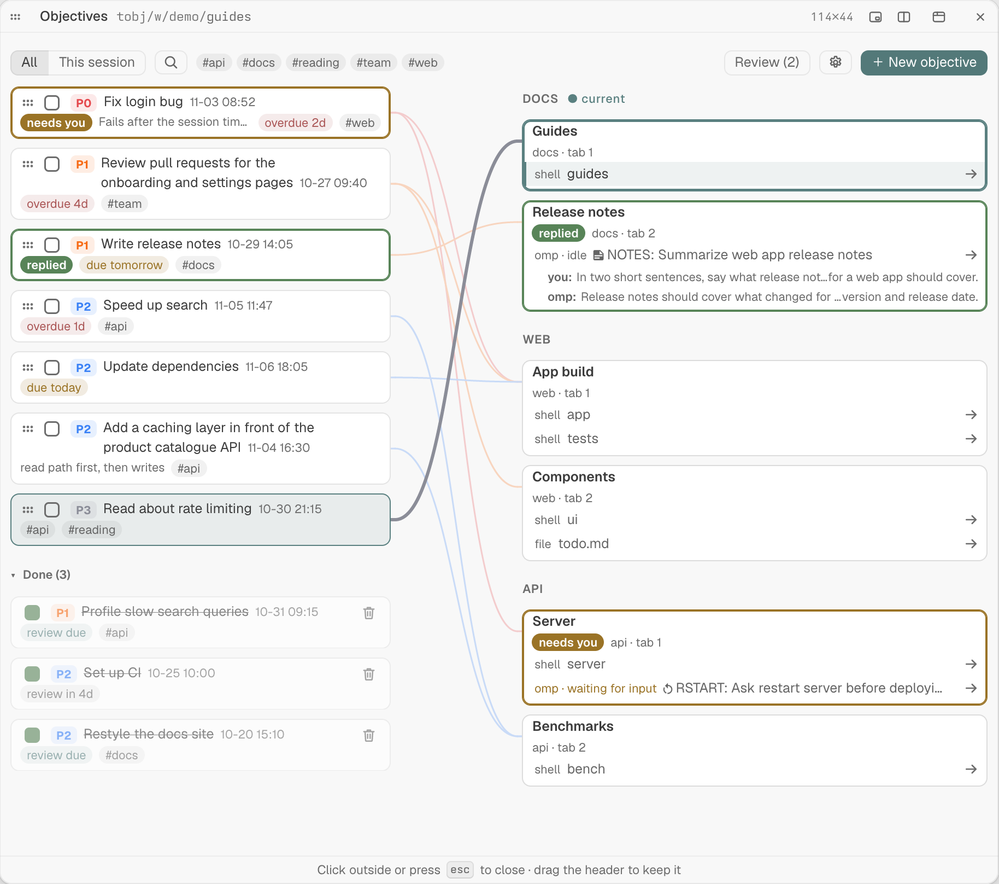

# Objectives for Tern

A [Tern](https://docs.stencil.so/tern) plugin that keeps one global list of objectives and links each one to the tabs where its work happens. It opens as a clickable graph: objectives on the left, tabs on the right, and a line for every link. Clicking a tab or a pane jumps straight to it, in any session.



## Install

```sh
tern plugin install github.com/JakobMusik/tern-objectives
```

The plugin has two halves. The window half (`window.luau` and `lib/`) keeps the objectives and builds the graph; the host half (`host.luau`) only shows the graph in its popup and passes your clicks back. It needs nothing on `PATH` besides the `git` that `tern plugin install` uses to fetch it.

## Commands

| Command | Key | What it does |
|---|---|---|
| Objectives: Open graph | ⌃⌘O | Shows the graph over the current tab; pressed again while it is shown, closes it. Esc closes it too. |
| Objectives: Link this tab… | | Picks an open objective to link to, or unlink from, the focused pane's tab. Linked objectives show a check. |
| Objectives: New objective for this tab… | | Asks for a title and creates a P2 objective already linked to the focused pane's tab. |

The key can be changed like any other: bind a chord to `plugin.objectives.open` in Tern's keybind settings.

## Using the graph

- **＋ New objective** asks for a title. The new objective is selected, so every tab shows a ＋ to link it.
- **Click an objective** to select it: its lines get thicker, the others fade, and each tab shows ＋ (link) or × (unlink). Click it again, or empty space, to clear the selection.
- **The box** marks an objective done; done objectives move to the **Done** group at the bottom and draw no lines. **P0–P3** cycles the priority (red, orange, blue, grey). **⋯** renames, sets a one-line side note, a due date or tags, or deletes it.
- **Click a tab header** to jump to that tab, or **a pane row** to jump to that pane, in whatever session it lives. **▸** shows what a pane is doing: an omp agent's state with your last message and its last reply, a terminal's last or running command, or a file's path.
- **All / This session** and the **#tag** chips filter the graph; the choice is remembered.
- Tabs with no link are drawn faded. A linked tab that closes stays as a ghost under **Closed tabs**, links kept, until **Prune closed tabs**; tabs held by another Tern window show under **Other windows**.

## Data

Everything the plugin keeps lives in one file in Tern's plugin data folder:

```
<Tern config>/plugin-data/objectives/kv.json
```

On macOS that is `~/Library/Application Support/Tern/plugin-data/objectives/kv.json`. While the graph is shown, the same folder also holds `view-<window>.json` and `view-<window>.seq`, the drawn graph handed to its popup; they are removed when it closes. The plugin writes nothing into your project folders, your home folder or its own package folder.

## Remove

```sh
tern plugin remove objectives
```

Removing the plugin leaves `plugin-data/objectives/kv.json` in place; delete that folder by hand to drop your objectives too.

## Known limits

- Side notes are one line of up to 200 characters. Tern's one-line field joins pasted lines without a space, so put a space or punctuation at the end of a line before pasting.
- The graph opens only in sessions on this machine. In a session on a machine attached over SSH, ⌃⌘O shows a note instead.

## License

MIT © 2026 nyclanker
